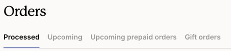
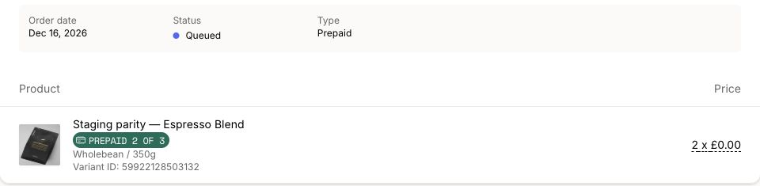
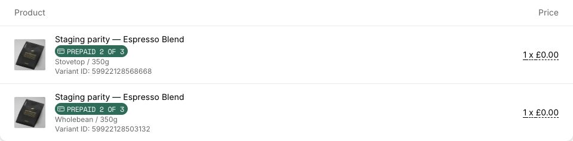
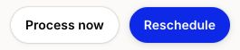
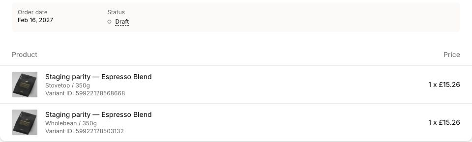
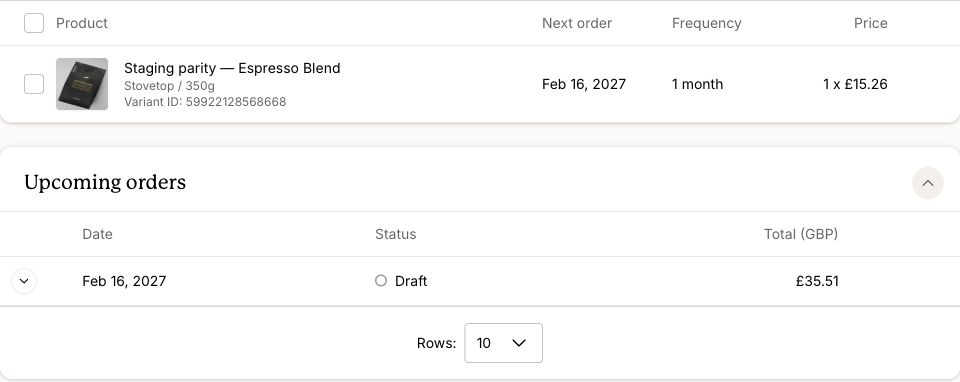

# Three-delivery coffee offer staff guide

This is the planned process for the website offer. The public offer is
currently off. Use this guide for warehouse, customer support and launch
briefing. The [launch checklist](INTRODUCTORY_SUBSCRIPTION_OFFER.md) tracks
what has passed and what still needs testing.

## What the customer buys

The customer pays upfront for three monthly deliveries at 25% off. One
bundle covers all three. Shopify shows the full checkout total, including
shipping. Once the prepaid payment is verified, the system sets up the
monthly subscription and schedules its first payment for the end of the
original prepaid period. The starting monthly coffee price is 10% off the
price at purchase. Recharge handles monthly billing and shipping charges.

## What happens after checkout

| When | What happens automatically | What staff do |
| --- | --- | --- |
| At purchase | Shopify takes the prepaid payment and creates the first order. Recharge schedules the remaining two shipments. After payment is verified, the monthly subscription appears with a future billing date. | Pick, pack and dispatch the first order as usual. Check that Shopify shows the order as **Fulfilled** once it’s dispatched. |
| About one month later | Recharge creates a Shopify order for delivery two. The merchandise is already paid for. | Dispatch the second order and check it shows as **Fulfilled**. |
| About two months after purchase | Recharge creates the Shopify order for delivery three. The merchandise is already paid for. | Dispatch the third order and check it shows as **Fulfilled**. |
| On the scheduled first monthly billing date | Recharge takes the first monthly payment and creates the monthly order. | Refer payment or subscription questions to whoever manages Recharge. |

For example, for a bundle bought on the 15th, the usual shipment dates are
the 15th of that month and the 15th of each of the next two months. The
first monthly payment ordinarily falls on the 15th of the fourth month.
Check the recorded date in Recharge. A late shipment leaves that date in
place.

## What staff and customers see

| When | Shopify Orders | Recharge |
| --- | --- | --- |
| First checkout | One **Paid** order for one bundle. The coffee subtotal covers all three deliveries at 25% off. Shipping is shown separately. Pack **one delivery**. | One prepaid payment and the three-shipment schedule. The next two prepaid shipments are queued at **£0**. Once the payment and schedule are verified, a separate **Active** monthly subscription shows the first billing date and monthly coffee price. |
| Second and third prepaid shipments | A separate **£0** order appears each time Recharge processes the shipment. Pack one delivery from each order and mark it **Fulfilled** after dispatch. | The corresponding shipment moves out of the upcoming queue and links to its Shopify order. An **Expired** label on the prepaid billing plan can appear after its one upfront payment. Check the shipment queue for what is still due. |
| First monthly payment | A new paid monthly order appears when payment succeeds. It covers one delivery. | The active monthly subscription records the charge and shows the next monthly billing date. If payment fails, check the charge status and follow the normal Recharge payment support process. |

For coffee normally priced at £10, Shopify shows **£22.50** for the prepaid
bundle before shipping. The separate subscription starts at **£9 per month**
for coffee, with shipping shown separately. A purchased bundle and its
monthly subscription are linked but each has its own record.

The customer sees the bundle price, shipping and monthly terms before
paying. They receive the Shopify order confirmation. Any Recharge activation
email for the bundle should explain the single upfront payment and the
separate monthly subscription. Check a real confirmation at launch so staff
know exactly what customers receive. For any question about the next charge,
use the billing date on the active monthly subscription.

PostHog purchase, subscription setup and prepaid shipment alerts can carry
the original Shopify order number and a shared bundle reference. A shipment
alert means Recharge processed that shipment into Shopify. Use **Fulfilled**
in Shopify to confirm dispatch. Use the Recharge charge and matching Shopify
order to verify the first monthly payment while production first-payment
alerting is being verified.

## Finding the right screen in Recharge

Start at **Customers → Orders** in the Recharge sidebar. The tabs separate
already-processed orders, future payments and already-paid shipments.

| Screen | What belongs here | What to check |
| --- | --- | --- |
| **Orders → Processed** | The initial checkout and each shipment or paid renewal after processing. | Open the record and follow its Shopify order link. Processing is not dispatch: check **Fulfilled** in Shopify separately. |
| **Orders → Upcoming prepaid orders** | Remaining deliveries covered by the upfront payment. | Shipment date, **Queued**, **Prepaid**, delivery number, grind, size and quantity. |
| **Orders → Upcoming** | Future charges that have not been paid, including the monthly continuation after the three-delivery offer. | First charge date, coffee amount, shipping, total and payment status. |
| **Customers → Subscriptions** | The subscription records and their schedules. | Select the customer's monthly subscription and check its next order date, monthly frequency and price. An expired prepaid billing record does not mean its remaining paid shipments have been dispatched. |

The monthly subscription is created after the original payment is verified;
it is visible before its first payment is due. Its future charge belongs in
**Upcoming**, not **Upcoming prepaid orders**. Staff do not need to create a
new subscription at the end of month three.

### Example: already-paid deliveries

These cropped screenshots were taken in staging on 17 November 2026. They
illustrate the screen layout, not production prices or a live customer's
account. Customer, address and payment details are excluded.

This queued example contains **two Wholebean 350g units** for delivery two.
**2 × £0.00** means both units are already paid for. Pack the listed quantity
for this delivery, not all three months at once.

A basket with two different variants instead shows **two separate lines**:
one Stovetop and one Wholebean. Here both are marked **Prepaid 2 of 3**, each
at £0. The delivery counter is separate from the quantity purchased.

Normally Recharge processes each queued prepaid shipment automatically on
its scheduled date and creates its Shopify order. Fulfilling the previous
Shopify order does not trigger the next shipment.

To bring an agreed prepaid shipment forward, the Recharge operator opens
**Orders → Upcoming prepaid orders**, finds the customer, then opens the
specific queued shipment. Check the delivery number, date, variants and
quantities before choosing **Process now** at the top. **Reschedule** is the
separate control for changing its date. Do not use **Add product** to trigger
an existing shipment.

After processing, find it under **Processed**, follow the Shopify order link,
and pick, pack and fulfil that order normally. If the outcome is unclear,
check both systems before trying again. Bringing a prepaid shipment forward
does not itself bring forward the separate monthly billing date.

### Example: monthly payments after the prepaid period

For the example purchased on 16 November, the monthly continuation's first
charge is scheduled for **16 February**. The upcoming charge shows one
Stovetop and one Wholebean at **£15.26 each**, rather than £0 prepaid lines.
In this staging example, £30.52 coffee plus £4.99 shipping totals £35.51.
Always read the actual charge total; example prices are not a price list.

The subscription detail shows its **next order**, **1 month** frequency and
unit price. Its upcoming order may show the total for a shared charge that
includes another subscription at the same address; compare all charge lines
before interpreting that total as the price of one product.

On the scheduled billing date, Recharge attempts payment and, when it
succeeds, creates the paid Shopify order. **Process now** on this paid
monthly charge would attempt a payment early; it is different from processing
an already-paid £0 prepaid shipment. Warehouse staff should leave monthly
billing changes to the Recharge operator following the agreed customer
support process.

## What the warehouse needs to do

Pick, pack and dispatch each Shopify order as usual. Mark the order
**Fulfilled** after dispatch. Staff can use Shopify fulfilment as their
dispatch record without a carrier-delivered update.

Recharge schedules all three prepaid shipments at purchase. If an earlier
Shopify order is still **Unfulfilled**, the next prepaid order can still
appear on its scheduled date. Check any outstanding order through the usual
dispatch workflow and record fulfilment once it has shipped. Raise late or
missing shipments through the usual dispatch process. The first monthly
billing date stays on the original schedule.
[Recharge prepaid shipment schedule](https://support.getrecharge.com/hc/en-us/articles/360008830433-Changing-the-product-or-swapping-variants-for-an-existing-prepaid-subscription)

A production sample on 15 November 2026 found 18 recent subscription orders
with the exact successful single-item fulfilment the worker expects. One
recent subscription order was still unfulfilled. None of the 25 fulfilled
orders in the wider sample had a carrier-delivered status. The previous
pilot's three orders also passed the same fulfilment check, including the
two prepaid follow-ups.

## If something looks wrong

| What you see | What to check |
| --- | --- |
| A prepaid shipment order is missing in Shopify | Check the next shipment date and order status in Recharge. Send the original Shopify order number and the missing shipment month to the person who manages Recharge. |
| The parcel was dispatched but Shopify still shows **Unfulfilled** | Check the dispatch record and complete or correct the normal Shopify fulfilment for that order. |
| The monthly subscription or its first billing date is missing after payment | Send the original Shopify order number to the person who manages Recharge. They can check the payment, the prepaid schedule and the linked monthly subscription. |
| A prepaid order is cancelled or prepaid merchandise is refunded before first monthly billing | Check in Recharge that the linked monthly subscription is cancelled and the queued charge is gone. Escalate to the Recharge operator if it is still queued or has already been paid. |
| The customer requests a pause or another subscription change | Route it through the usual support process so payment, shipment and subscription records can be checked together. |

## First live order

James will enable the offer and place one order on an eligible coffee.
Before payment, check the correct grind and size, one three-delivery bundle,
the 25%-off subtotal, shipping, and the first monthly payment terms.

After payment, match Shopify’s original order to Recharge. Confirm the one
prepaid payment, the two upcoming £0 shipments, and exactly one active
10%-off subscription with its first payment three months after purchase.
Check the customer email and the purchase and subscription setup alerts.
Capture the original order number for staff follow-up. During a supervised
test, processing a £0 shipment early is a manual test step. On ordinary
orders Recharge processes those shipments automatically on the scheduled
dates. Check that the first monthly billing date stays in place.

Staging order #1027 verified the three prepaid orders and a manually
processed first monthly payment reaching Firebase. Scheduled first-payment
alerting and the first public production purchase still need verification.
See [FLY-190](https://linear.app/flyinghorsecoffee/issue/FLY-190) and
[FLY-192](https://linear.app/flyinghorsecoffee/issue/FLY-192).
